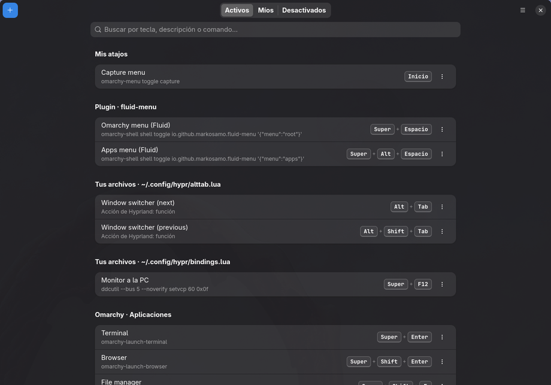

<p align="center">
  
</p>

# Fluid Shortcuts

**Shortcuts** is a native GTK4 / libadwaita app for managing your Hyprland
keyboard shortcuts on [Omarchy](https://omarchy.org/). It lists every binding
that is actually loaded (Omarchy's defaults, your own files and plugins) and
lets you add, change, move or turn off shortcuts without editing Lua by hand.



## What it does

- **Shows everything that is bound**, grouped by where it comes from
  (Omarchy · Applications, Omarchy · Tiling, your files, plugins…), with
  search by key, description or command.
- **Three views:** *Activos* (what works right now), *Míos* (yours) and
  *Desactivados* (bindings that were removed or replaced, and by which file).
- **New shortcuts** (`+` or `Ctrl+N`): press the combination to capture it
  or type it, give it a description and a command. You can launch it as an
  app (`uwsm-app`), keep it working on the lock screen, and let it repeat
  while the key is held.
- **Conflict warnings:** it tells you when a combination is already taken
  (and replaces that binding), and when a key without modifiers would stop
  working inside your apps.
- **Any existing binding** can be moved to another combination, given a
  different action, or turned off. Delete your replacement and the original
  comes back.
- **Safe saves:** every change is checked by loading the config in Lua, then
  `hyprctl reload` and `hyprctl configerrors`. If anything fails, the change is
  rolled back and you see the error.

The UI is in Spanish.

## How it stores changes

Shortcuts never edits Omarchy's files (`/usr/share/omarchy`) or your
`bindings.lua`. It owns two files:

| File | What it is |
|------|------------|
| `~/.config/hypr/shortcuts.json` | Your shortcuts and disabled bindings, the source of truth |
| `~/.config/hypr/shortcuts.lua` | Generated from the JSON on every save; don't edit it |

The first time you save, it appends two lines to the end of
`~/.config/hypr/hyprland.lua` (after making a `.bak` copy) so your shortcuts
load last and win over everything else:

```lua
-- fluid-shortcuts (remove with uninstall.sh)
do local f = (os.getenv("HOME") or "") .. "/.config/hypr/shortcuts.lua"; local h = io.open(f) if h then h:close() dofile(f) end end
```

The hook only loads the file if it exists, so deleting `shortcuts.lua` never
leaves Hyprland with a broken config.

To read bindings, it runs your real `hyprland.lua` with a stubbed `hl` (the
same technique `omarchy-menu-keybindings` uses), so it knows the file and
line of every `o.bind` / `hl.unbind`.

## Requirements

- Omarchy with the Lua Hyprland config (`~/.config/hypr/hyprland.lua`).
- `python-gobject`, `gtk4`, `libadwaita` ≥ 1.7 and `lua`, all of which ship
  with Omarchy.

Nothing runs with elevated privileges and nothing is downloaded.

## Install

```bash
git clone https://github.com/markosAMO/fluid-shortcuts.git
cd fluid-shortcuts
./install.sh
```

This copies the app to `~/.local/share/fluid-shortcuts`, links the
`shortcuts` command into `~/.local/bin`, and adds the icon and the
**Shortcuts** entry to your app launcher.

## Uninstall

```bash
~/.local/share/fluid-shortcuts/uninstall.sh          # keeps your shortcuts.json
~/.local/share/fluid-shortcuts/uninstall.sh --purge  # also deletes it
```

The uninstaller removes the hook from `hyprland.lua` (with a backup) and
reloads Hyprland, so Omarchy's defaults come back.

## Command line

```bash
shortcuts            # open the app
shortcuts --list     # every binding: key, description, origin, file:line (x = removed)
shortcuts --render   # print the shortcuts.lua that would be generated
```

## Known limitation

When you capture a combination that Hyprland already uses (for example
`Super+K`), Hyprland handles it before the app sees it. Type it in the text
field instead.

## License

MIT
